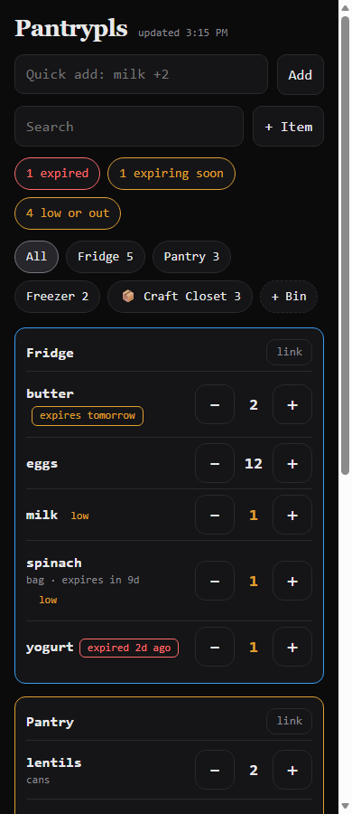
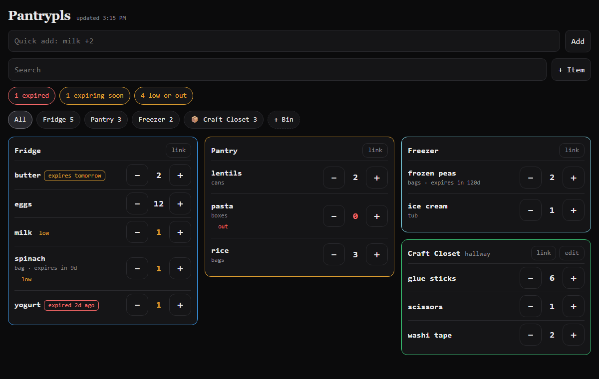

# Pantrypls

A tiny, self-hosted pantry, fridge and storage-bin tracker for two people. No login, no cloud, no app store: it is one web page that lives on your own server and works from any phone on your private network.

<p>
  
  
</p>

*(Screenshots use made-up sample items.)*

## Why it exists

It started as a Discord bot so a household could track what is in the fridge. The Discord part turned out to be the weak point: one person used it and the other did not. Pantrypls keeps the good parts (typing `milk +2`, expiry warnings, low-stock warnings, a link you can put on an NFC sticker) and replaces Discord with a page both people can open and edit.

## What it does

| Feature | How it works |
|---|---|
| Places | Fridge, Pantry and Freezer always show. Any new location you type becomes its own card. |
| Bins | Named storage bins (a craft closet, a toolbox) get their own card and their own link. |
| Change a quantity | Big **+** and **-** buttons on every row. Two people tapping at once both count. |
| Typing shorthand | `milk +2`, `eggs -3`, `eggs =6`, `yogurt +1 exp:2026-12-01 loc:fridge`. One item per line. A last line like `loc:freezer` sets the location for the whole batch. |
| Warnings | Amber when an item is at or below its low-stock level, red when it is out or expired, and an amber badge when it expires within 3 days (you can change the 3). |
| Edit an item | Tap its name: name, unit, low-stock level, expiry date, location, delete. |
| Search and filters | Search box, plus chips for each place and for "expired", "expiring soon" and "low or out". |
| NFC links | Every card has a **link** button that shows a permanent address like `/loc/fridge` or `/bin/3`. Write it onto an NFC tag and tapping the tag opens that card. |
| Stays fresh | The page re-checks the server every 30 seconds and whenever you switch back to it. |
| Install on a phone | It has a manifest and icons, so "Add to Home Screen" gives it an app icon. |

## Quick start

You need Docker with Compose.

```bash
git clone https://github.com/vernalynt/pantrypls.git
cd pantrypls
cp .env.example .env        # then open .env and set your timezone
docker compose up -d --build
```

Open <http://localhost:5056>.

### Using it from your phone

By default it only listens on the computer it runs on. To reach it from phones, set `BIND_IP` in `.env` to a **private** address of that machine, for example the one from `tailscale ip -4` if you use [Tailscale](https://tailscale.com/), then set `PUBLIC_BASE_URL` to the same address:

```
BIND_IP=100.x.y.z
PUBLIC_BASE_URL=http://100.x.y.z:5056
```

Restart with `docker compose up -d`, then open that address on the phone.

## Settings

All settings live in `.env` (see `.env.example`).

| Setting | Default | What it does |
|---|---|---|
| `BIND_IP` | `127.0.0.1` | Which address the port is published on |
| `PORT` | `5056` | The port |
| `TZ` | `UTC` | Your timezone. It decides what "expires today" means. |
| `PUBLIC_BASE_URL` | `http://localhost:5056` | What the NFC links start with. Use the same address your phones use. |
| `EXPIRY_WARN_DAYS` | `3` | Days before expiry that the amber badge appears |

## NFC tags

The links are plain web addresses, so any NFC writer app can put one on a tag. Open the app, tap **link** on a card, and write that address to a tag. Two tips:

- Use the **IP address** form in `PUBLIC_BASE_URL`, not a machine name. Names can differ between devices, and rewriting a tag is a physical chore.
- Bin links use the bin's number (`/bin/3`), so renaming a bin never breaks its tag.

## Security: read this

**There is no login.** Anyone who can reach the page can change your pantry. That is a deliberate trade for simplicity, so keep it on a private network.

| Protection | What it does |
|---|---|
| Private bind address | The port is published on one address you choose, `127.0.0.1` by default |
| JSON only | Write requests must be real JSON, which a plain web form cannot send |
| Same-site guard | A write that comes from another website's page is refused with `403` |
| No secrets | The app stores no passwords or keys |

**Do not publish the port to the open internet.** Also note that [Docker's own documentation](https://docs.docker.com/engine/network/packet-filtering-firewalls/) says published container ports can bypass a host firewall like `ufw`, which is why this project binds to a specific address instead of relying on the firewall.

## Your data and backups

Everything is in one SQLite file: `data/pantry.db`. To back it up, use SQLite's own backup, because copying a database file while the app is writing to it can give you a damaged copy:

```bash
python3 - <<'PY'
import sqlite3
src = sqlite3.connect("data/pantry.db")
dst = sqlite3.connect("pantry-backup.db")
src.backup(dst)
PY
```

The same project family includes a full server backup script in the `mewseum` repository, which does this for you.

## Run it without Docker (development)

```bash
python -m venv .venv
. .venv/bin/activate            # Windows: .venv\Scripts\activate
pip install -r requirements.txt
DATA_DIR=./data flask --app app run --port 5056
```

Run the tests (21 of them, each with its own empty database):

```bash
python -m unittest discover -s tests -v
```

## How it is built

One Flask file (`app.py`), one HTML file with plain JavaScript (`static/index.html`), SQLite, and gunicorn in the container. No front-end build step.

- Quantity changes are a single atomic SQL statement (`quantity = MAX(0, quantity + ?)`), so two phones never overwrite each other.
- The edit box only sends the fields you actually changed, for the same reason.
- "Expiring soon" is worked out in Python from your local date, not the database's UTC date.
- The shorthand is matched by name, so names are unique ignoring case.
- The database layout is the one used by the earlier Discord version, so an old database opens without conversion.

## Honest limits

- The NFC links are ordinary URLs and have not been tested on a physical tag yet.
- There are no push notifications yet. Warnings show when you open the page. A self-hosted push service such as [ntfy](https://ntfy.sh/) is the planned next step.
- There are no user accounts.

## License

MIT, see `LICENSE`.
